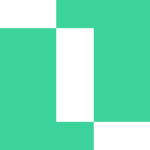
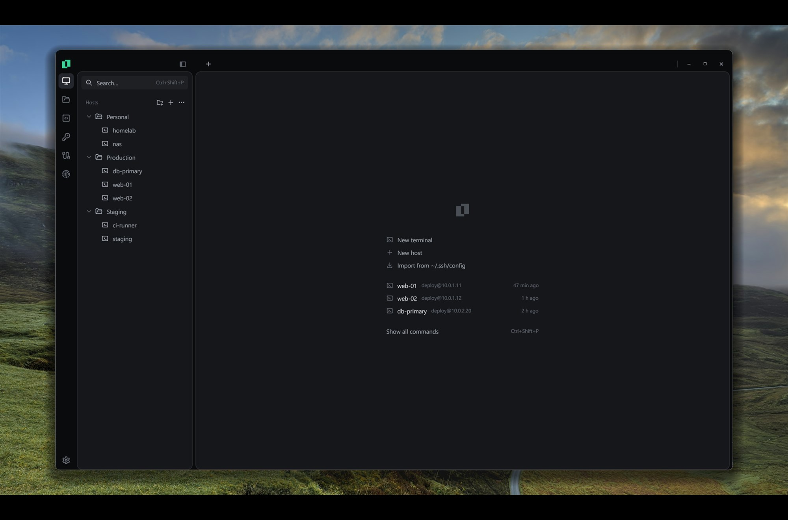
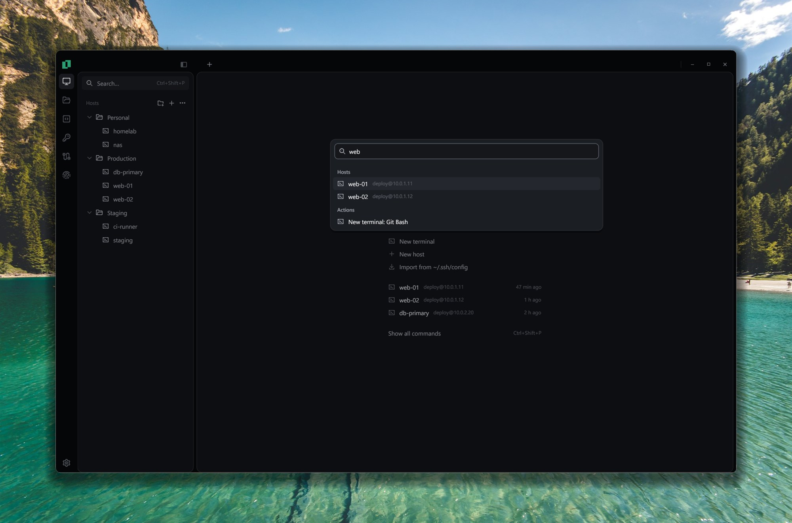
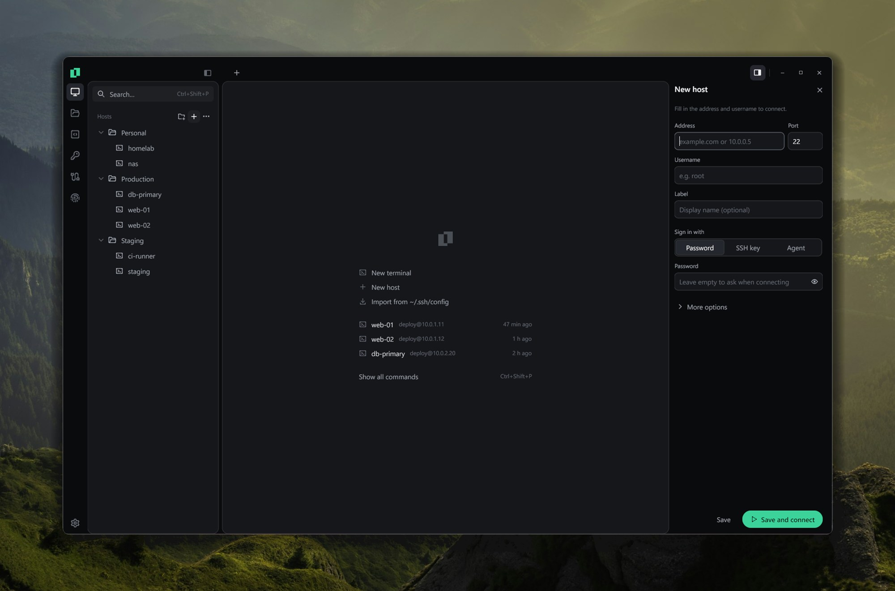
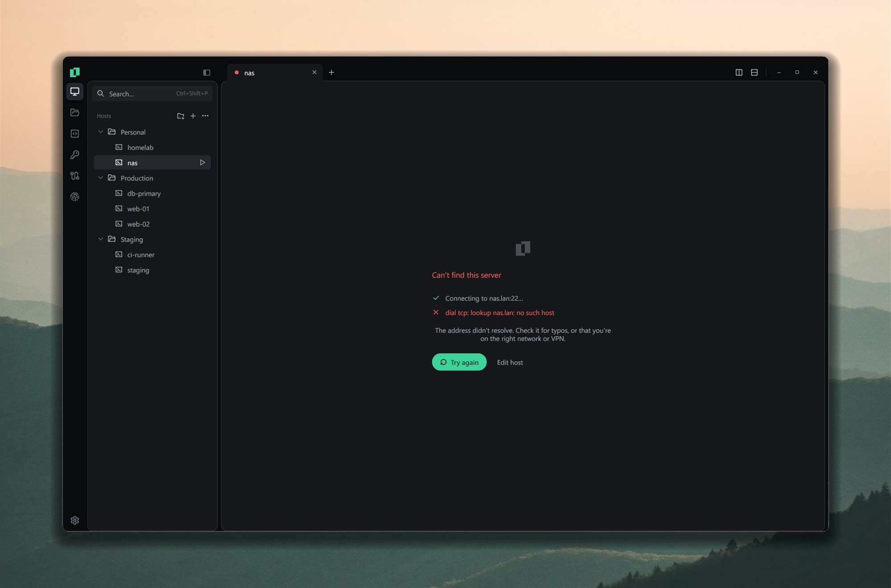
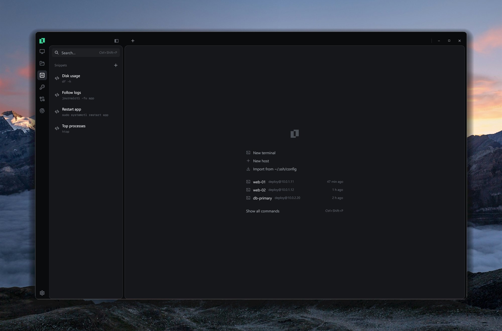
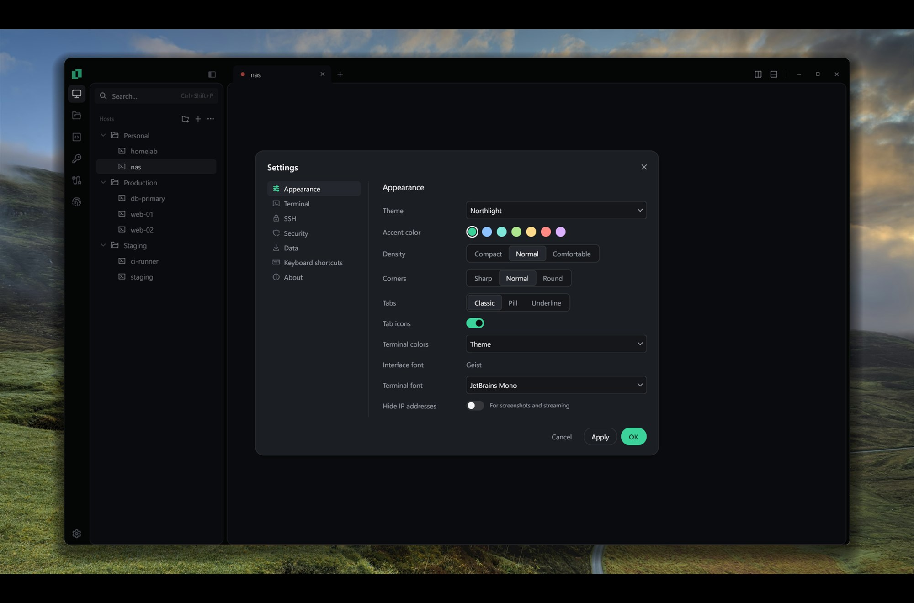

<p align="center">
  
</p>

<h1 align="center">Boreal</h1>

<p align="center">
  A native SSH client and terminal for Windows, macOS and Linux.
</p>

<p align="center">
  <a href="https://github.com/northlighthq/boreal/releases"></a>
  <a href="https://github.com/northlighthq/boreal/actions/workflows/ci.yml"></a>
  <a href="LICENSE"></a>
</p>

<p align="center">
  <a href="https://github.com/northlighthq/boreal/releases"><b>Download</b></a> ·
  <a href="https://northlighthq.github.io/plattyssh.github.io/">Website</a> ·
  <a href="CHANGELOG.md">Changelog</a>
</p>



##  Overview

Boreal brings a host manager, a terminal emulator of its own and the everyday SSH tools
into a single native window. It's written in Go and drawn on the GPU with
[Gio](https://gioui.org), for people who live in SSH sessions and want them to be fast,
organized and safe.

- **Native and fast.** No browser engine. A full redraw at 1080p takes under 6 ms, and an
  idle screen costs 0.04 ms per frame.
- **Everything in one place.** Hosts, keys, tunnels, file transfers and snippets share the
  same window and the same search.
- **Private by default.** Hosts, keys and passwords live in an encrypted vault that only
  you can open.

##  Features

| Area | What's included |
|---|---|
| **Terminal** | Own VT emulator with truecolor, alternate screen, scrollback and reflow on resize · GPU glyph rasterizer with color emoji and ligatures · tabs and split panes restored on launch · broadcast input · scrollback search, clickable links, mouse reporting, OSC 7/8/52 · session logs |
| **Hosts** | Folders, tags and drag and drop · the server's OS shown per host · `~/.ssh/config` import · Search Everywhere (Ctrl+Shift+P) and quick connect |
| **Connections** | Password, key, SSH agent and keyboard-interactive auth · jump hosts · keep-alive and reconnect · host key verification · certificates, agent forwarding and FIDO keys · command on connect |
| **Tools** | Keychain with ed25519 generation and import · local, remote and SOCKS5 forwarding · SFTP with a transfer queue and remote editing · snippets · server metrics · output triggers |
| **Security** | XChaCha20-Poly1305 vault · key protected by the system (DPAPI, Keychain, Secret Service), an Argon2id master password, or both · lock on demand, when idle or with the session · Windows Hello, Touch ID and fingerprint unlock |
| **Data** | Encrypted `.boreal` export and import with secrets left out by default · export to `~/.ssh/config` |
| **Appearance** | Northlight theme with the Aurora accent, plus Carbon, Graphite, Midnight and Paper · density, corner and tab styles · option to hide IP addresses |

<table>
  <tr>
    <td></td>
    <td></td>
  </tr>
  <tr>
    <td></td>
    <td></td>
  </tr>
  <tr>
    <td colspan="2" align="center"></td>
  </tr>
</table>

##  Platforms

| System | Status | Download |
|---|---|---|
| Windows 10 (1809+) and 11, x64 | Supported | Installer or portable `.zip` |
| Windows 11 on ARM64 | Native builds, not yet tested on hardware | `arm64` installer or `.zip` |
| macOS 12+ (Apple Silicon and Intel) | Experimental, see [#1](https://github.com/northlighthq/boreal/issues/1) | `.dmg` |
| Linux x86_64 (X11 and Wayland) | Experimental, see [#2](https://github.com/northlighthq/boreal/issues/2) | `.AppImage` |
| Android 9+ | In development, see [docs/mobile.md](docs/mobile.md) | |

The SSH layer, the terminal engine and the vault are portable Go. The issues list what's
still missing on each system.

| Feature | Windows | macOS | Linux |
|---|---|---|---|
| Vault key in the system keyring | DPAPI | Keychain | Secret Service |
| Unlock without the password | Windows Hello | Touch ID | Fingerprint (fprintd) |
| Lock with the session | ✓ | ✓ | logind (`LockedHint`) |
| Open `ssh://` and `sftp://` links | ✓ | ✓ | ✓ (xdg-mime) |
| Trigger sounds | ✓ | ✓ | libcanberra, PulseAudio, PipeWire or ALSA |
| App shortcuts | Ctrl+Shift | ⌘ or Ctrl+Shift | Ctrl+Shift |
| Updates from inside Boreal | ✓ | Opens the release page | AppImage |
| Drop files to upload via SFTP | ✓ | ✓ | ✓ (Wayland and X11) |
| Drag files out of SFTP | ✓ | ✓ (file promises) | ✓ (Wayland and X11) |
| FIDO keys | Windows WebAuthn | Through an SSH agent | Through an SSH agent |

##  Getting started

### Download

Grab your build from [Releases](https://github.com/northlighthq/boreal/releases). Beta builds
aren't code-signed yet, so your system may ask you to confirm before running them.

### Build from source

You need **Go 1.26+**. Linux also needs the Gio libraries (Wayland, X11, Vulkan and
xkbcommon headers).

```sh
# Windows
go build -ldflags "-H windowsgui" -o bin/boreal.exe ./cmd/boreal

# macOS and Linux
go build -o bin/boreal ./cmd/boreal
```

Settings, the vault and the crash log live in the user config folder: `%AppData%\Boreal`,
`~/Library/Application Support/Boreal` or `~/.config/Boreal`.

### Development

```sh
./packaging/build.ps1 -Version 0.1.0   # Windows portable zip in dist/, add -Installer for the setup
```

Run with `BOREAL_DIAG=<folder>` to write the frame rate, memory stats and CPU and heap
profiles to that folder every few seconds.

##  Tech stack

| Layer | Technology |
|---|---|
| Language | Go 1.26, no cgo on Windows |
| UI | Gio 0.10 (Direct3D 11, Metal, Vulkan) · Lucide and Phosphor icons · Geist and JetBrains Mono |
| Terminal | `libs/vt` emulator · `libs/pty` (ConPTY, `/dev/ptmx`) · `libs/glyphs` rasterizer |
| SSH | `golang.org/x/crypto/ssh` · `pkg/sftp` |
| Storage | XChaCha20-Poly1305 vault · key wrapped with DPAPI, Keychain or Secret Service, and/or Argon2id |

<details>
<summary><b>Project structure</b></summary>

```
boreal/
├── cmd/boreal/            # entry point: desktop on Windows, macOS and Linux, mobile on Android
├── internal/
│   ├── core/              # no UI, shared by every app
│   │   ├── session/       # local and SSH sessions
│   │   ├── sshx/          # SSH: auth, host keys, jump hosts, forwarding, SFTP, metrics
│   │   ├── vault/         # encrypted storage
│   │   └── tunnel/  transfer/  config/  backup/  secure/  sshconfig/  update/ ...
│   ├── common/            # UI shared by desktop and mobile
│   │   └── kit/  termview/  theme/  icons/  toast/  fonts/  metrics/ ...
│   ├── desktop/           # the desktop app: sidebar, tabs, split panes and wiring
│   │   ├── base/          # interfaces between the window and its parts
│   │   ├── hosts/  keychain/  forwards/  snippets/  knownhosts/  sftp/
│   │   └── settings/  palette/  welcome/  dialogs/
│   ├── mobile/            # the Android app: screens, navigation and touch controls
│   │   ├── ui/  nav/      # mobile design system and screen stack
│   │   └── hosts/  terminal/  keys/  snippets/  settings/  lock/
│   └── platform/          # OS integration: local shells, file drop, keyring, Hello
├── libs/                  # reusable libraries, each with its own go.mod
│   ├── vt/                # terminal emulator (parser/, input/)
│   ├── pty/               # pseudo terminals (ConPTY, Unix)
│   └── glyphs/            # glyph rasterizer
└── packaging/             # release scripts, installer, icons and the Android build
```

The libraries in `libs/` are also published as their own repositories under
[github.com/northlighthq](https://github.com/northlighthq); the main module uses them through
`replace` directives.

</details>

##  Status

Boreal is in early development: expect rough edges, and please report what you find in the
[issues](https://github.com/northlighthq/boreal/issues).

Released under the [MIT license](LICENSE). The embedded fonts (JetBrains Mono, Fira Code,
Geist and Geist Mono) are under the SIL Open Font License 1.1, and the icons come from
Lucide (ISC) and Phosphor (MIT).
