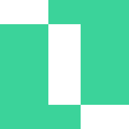
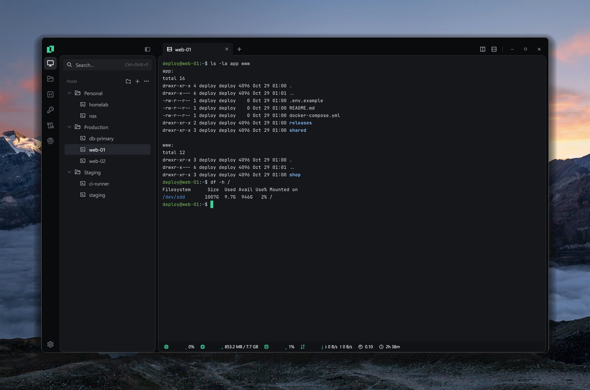
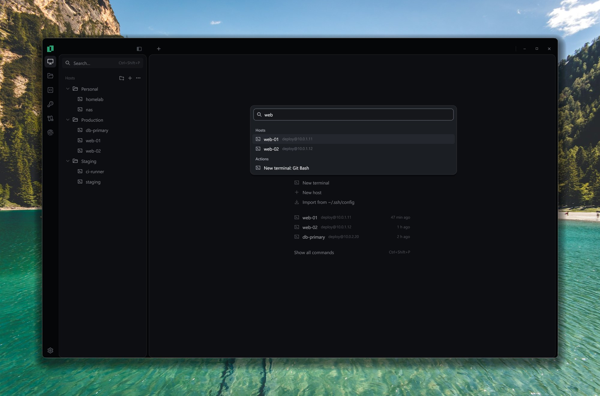
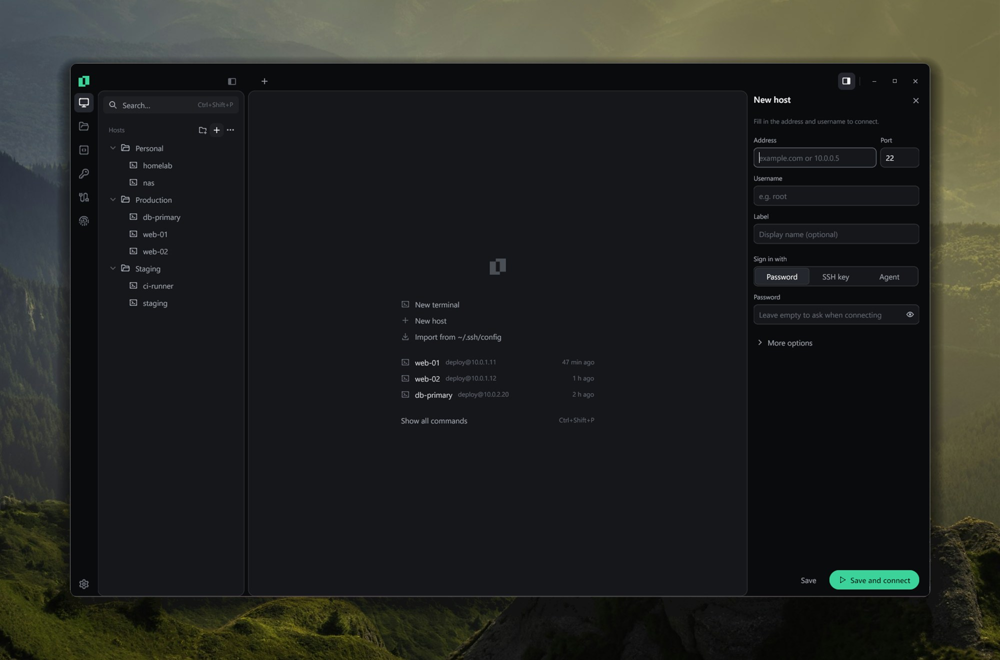
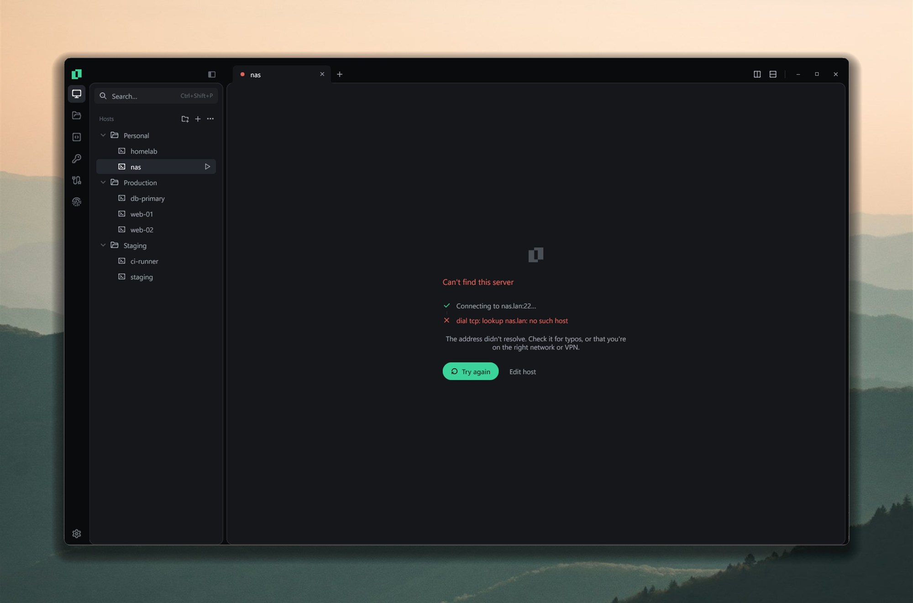
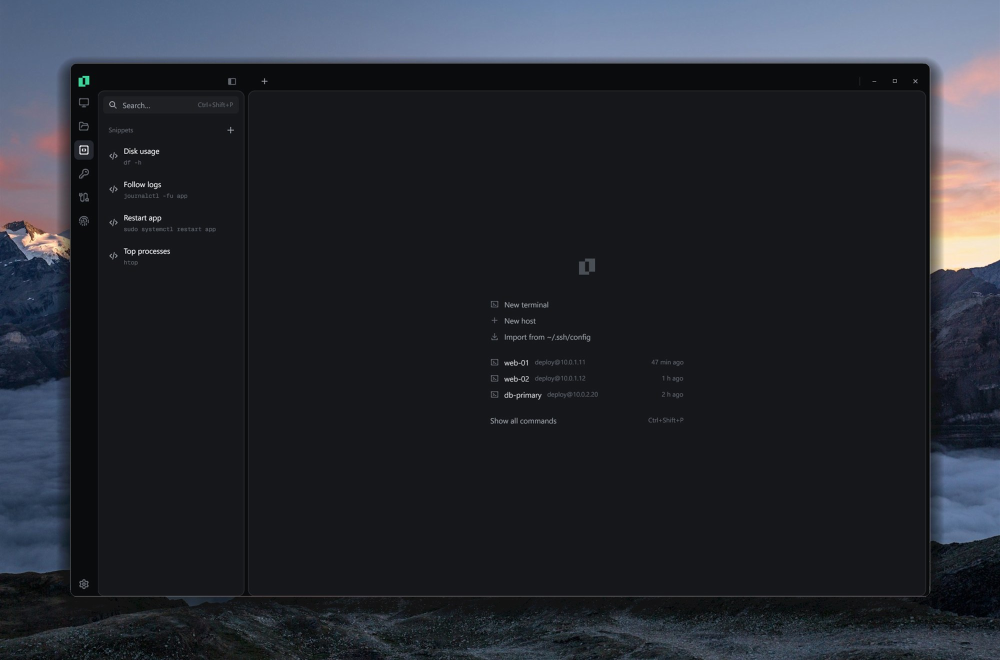
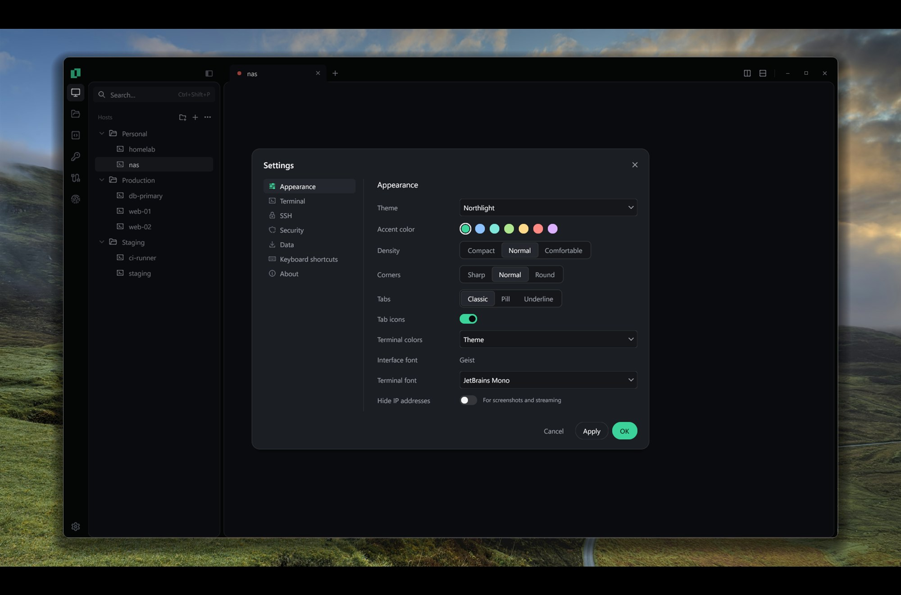

<div align="center">



# Boreal

**A fast, native SSH client and terminal for Windows, by [Northlight](https://github.com/northlighthq).**

No Electron, no web view: Boreal is written in Go and draws its whole interface on
the GPU with [Gio](https://gioui.org). It brings a **Termius-style host manager**, a
**terminal emulator of its own** and the everyday SSH tools (**keys, tunnels, SFTP and
snippets**) into one calm window, with an activity bar for the tools and the Northlight look.

</div>

---



## ✨ Features

- **Terminal of its own** (`libs/vt`): 256 colors and truecolor, bold, italic and
  underline styles, alternate screen, scrollback, wide (CJK) characters and **reflow on
  resize**.
- **Custom glyph rasterizer** with a cache: 0.04 ms per frame on a static screen and
  under 6 ms for a full-screen redraw at 1080p, with **color emoji** (COLR v0/v1) and
  system font fallback.
- **Selection, copy and paste**, bracketed paste, **search in the scrollback**, Ctrl+click
  links and mouse reporting for vim and htop.
- **Tabs and split panes** that come back when you reopen Boreal; rename, reorder, duplicate,
  and type into several panes of a tab at once (broadcast), choosing which ones receive the
  input. Local profiles: PowerShell, cmd,
  WSL and Git Bash.
- **Font ligatures** (JetBrains Mono, Fira Code), clickable OSC 8 links, OSC 52 copy and
  OSC 7 working folder; **save a session to a log file** as plain text.
- **Hosts in folders**: subfolders, drag and drop, tags, search and **`~/.ssh/config`
  import**.
- **Authentication** with a password, a key from the keychain or the Windows OpenSSH
  agent, including keyboard-interactive; **jump hosts**, keep-alive and reconnect.
- **Host key verification** (trust on first use) with a warning when a key changes.
- **SSH certificates** attached to keys, **agent forwarding** and a **command to run on
  connect** per host. Hardware keys (YubiKey, FIDO) work through the Windows OpenSSH agent.
- **Keychain**: generate ed25519 keys (with a passphrase) or import existing ones.
- **Port forwarding**: local (-L), remote (-R) and dynamic (SOCKS5), each with a switch.
- **SFTP panel** with a **transfer queue** (progress, cancel, whole folders): drag files in
  from Explorer or out to it, edit a remote file in your own editor and it uploads on save.
- **Snippets**: saved commands you run in the active session with one click.
- **Server metrics** for SSH sessions: CPU, memory, disk, network, load and uptime.
- **Search Everywhere** (Ctrl+Shift+P): hosts, snippets, actions and quick connect.
- **A short introduction** on first launch: theme, terminal, master password and
  importing your servers.
- **Encrypted vault** (XChaCha20-Poly1305): opens with your Windows user, an optional
  **master password** (Argon2id), or both; **locks** on demand (Ctrl+Shift+L) or when idle.
  Key passphrases are only kept for the session unless you ask Boreal to remember them.
- **Export and import**: a `.boreal` file encrypted with a password of your choice, where
  you pick what goes in (secrets stay out by default), plus export to `~/.ssh/config`.
- **Themes**: Northlight (the default, with the Aurora accent) plus monochrome Carbon, Graphite, Midnight and Paper, and an option to hide
  IP addresses on screen.

| | |
|---|---|
|  |  |
|  |  |
|  | |

## 🧱 Tech stack

| Layer | Technology |
|-------|------------|
| Language | Go 1.26 · no cgo on Windows |
| UI | Gio 0.10 (Direct3D 11) · Lucide and Phosphor icons · Segoe UI, Geist and JetBrains Mono |
| Terminal | Own VT emulator (`libs/vt`) · pseudo terminals with ConPTY or `/dev/ptmx` (`libs/pty`) · own glyph rasterizer (`libs/glyphs`) |
| SSH | golang.org/x/crypto/ssh · pkg/sftp |
| Storage | XChaCha20-Poly1305 vault · key wrapped with DPAPI or the system keyring and/or Argon2id · JSON settings |

## 🚀 Getting started

### Download

Grab the installer or the portable `.zip` from [Releases](https://github.com/northlighthq/boreal/releases);
on Windows on ARM, pick the `arm64` files for a native build. Boreal needs **Windows 10 1809** or later. Beta builds aren't code-signed yet, so Windows may
ask you to confirm before running them.

### Build from source

You need **Go 1.26+**.

```sh
# Build the app
go build -ldflags "-H windowsgui" -o bin/boreal.exe ./cmd/boreal

# Run it
bin/boreal.exe
```

Settings, the vault and the crash log are kept in `%AppData%\Boreal`; an existing `%AppData%\Platty` folder moves there on first launch.

### Development

```sh
./packaging/build.ps1 -Version 0.1.0          # portable zip in dist/ (add -Installer for the setup)
```

Run with `BOREAL_DIAG=<folder>` to write the frame rate, memory stats and CPU/heap
profiles to that folder every few seconds.

## ⌨️ Shortcuts

| Action | Shortcut |
|---|---|
| Search everywhere | Ctrl+Shift+P |
| New terminal / new host | Ctrl+Shift+T / Ctrl+Shift+N |
| Split right / down | Ctrl+Shift+D / Ctrl+Shift+E |
| Close pane | Ctrl+Shift+W |
| Broadcast input to the tab | Ctrl+Shift+B |
| Move focus between panes | Alt+Arrows |
| Switch tab | Ctrl+Tab / Ctrl+Shift+Tab |
| Sidebar / tool panels | Alt+1 / Alt+2 … Alt+6 |
| Copy / paste | Ctrl+Shift+C (or Ctrl+C with a selection) / Ctrl+Shift+V |
| Find in terminal | Ctrl+Shift+F |
| Settings | Ctrl+Alt+S |
| Lock Boreal | Ctrl+Shift+L |

## 📚 Documentation

- [Website](https://northlighthq.github.io/plattyssh.github.io/): the landing page and documentation.
- [Changelog](CHANGELOG.md): what changed in each version.
- [Branding](https://github.com/northlighthq/branding): the Northlight brand.
- [Third-party notices](THIRD_PARTY_NOTICES.md): icon and font licenses.

## 📂 Structure

```
boreal/
├── cmd/boreal/            # the app
├── internal/
│   ├── app/               # the window: sidebar, tabs, split panes and wiring
│   │   ├── core/          # interfaces between the window and its parts
│   │   ├── hosts/  keychain/  forwards/  snippets/  knownhosts/  sftp/
│   │   └── settings/  palette/  welcome/  dialogs/
│   ├── session/           # local and SSH sessions
│   ├── sshx/              # SSH: auth, host keys, jump hosts, forwarding, SFTP, metrics
│   ├── vault/             # encrypted storage
│   ├── tunnel/  sshconfig/  config/  fonts/  format/  privacy/
│   ├── platform/          # OS integration: local shells, file drop, keyring
│   └── ui/                # theme, icons, component kit and widgets (termview, mark...)
├── libs/                  # reusable libraries, each with its own go.mod
│   ├── vt/                # terminal emulator (parser/, input/)
│   ├── pty/               # pseudo terminals (ConPTY, Unix)
│   └── glyphs/            # glyph rasterizer
└── packaging/             # release script, installer and icon
```

The libraries in `libs/` are also published as their own repositories under
[github.com/northlighthq](https://github.com/northlighthq); the main module uses them through
`replace` directives.

## 🖥️ Platform support

| System | Status |
|---|---|
| Windows 10 (1809+) and 11, x64 | ✅ Supported |
| Windows 11 on ARM64 | 🧪 Native builds, not yet tested on ARM hardware |
| macOS (Apple Silicon and Intel) | 🛠️ Planned, see [#1](https://github.com/northlighthq/boreal/issues/1) |
| Linux (X11 and Wayland) | 🛠️ Planned, see [#2](https://github.com/northlighthq/boreal/issues/2) |

The SSH layer, the terminal engine and the vault are portable Go; the issues list what's
left for each system.

## ⚠️ Notice

Boreal is in early development. Segoe UI isn't bundled: it's loaded from the Windows
fonts folder, and Geist is used when it's missing.

Released under the [MIT license](LICENSE). The embedded fonts (JetBrains Mono, Fira Code,
Geist and Geist Mono) are under the SIL Open Font License 1.1, and the icons come from
Lucide (ISC) and Phosphor (MIT).
